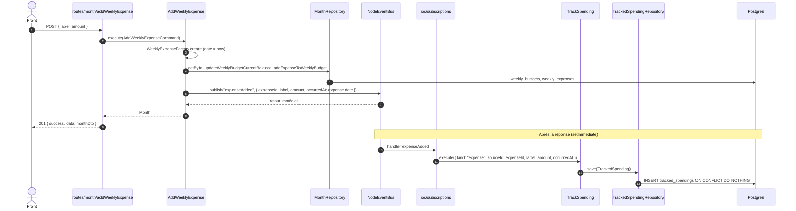
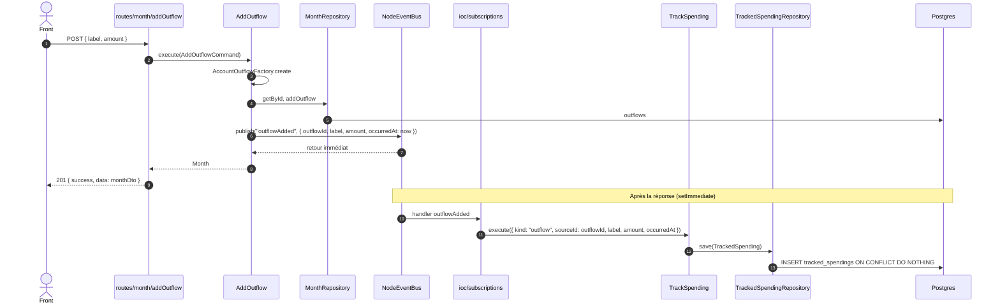
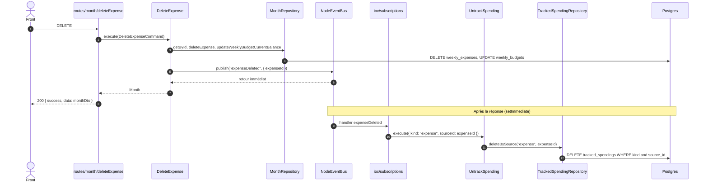
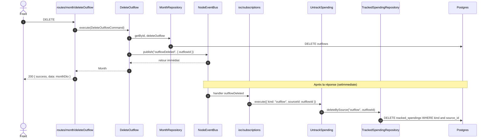
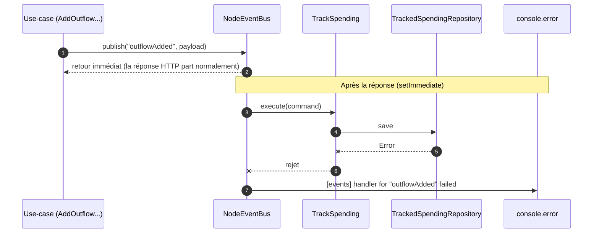
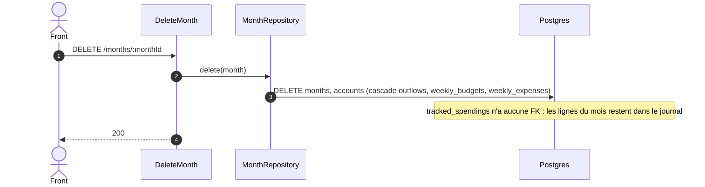
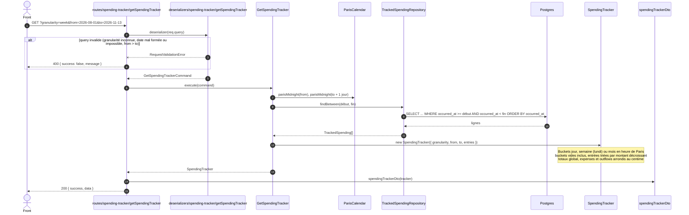

# Suivi des dépenses : workflows backend

Le suivi des dépenses (`spending-tracker`) tient un journal horodaté des dépenses hebdo (`expense`) et des sorties (`outflow`) ajoutées après la création d'un mois. Le journal est alimenté par des événements de domaine typés, traités hors du chemin de la requête. Il survit à la suppression des mois, car la table `tracked_spendings` n'a aucune clé étrangère.

Briques en jeu :

| Brique | Fichier |
|---|---|
| Carte des événements | `back/src/core/events/DomainEventMap.ts` |
| Ports | `back/src/core/ports/providers/EventPublisher.ts`, `EventSubscriber.ts`, `back/src/core/ports/repositories/TrackedSpendingRepository.ts` |
| Bus (adapter) | `back/src/providers/events/NodeEventBus.ts` |
| Abonnements | `back/src/ioc/subscriptions.ts` |
| Use-cases | `back/src/core/usecases/spending-tracker/{TrackSpending,UntrackSpending,GetSpendingTracker}.ts` |
| Persistance | `back/src/providers/persistence/repositories/TrackedSpendingRepository.ts`, table `tracked_spendings` |
| Route | `back/src/consumers/api/routes/spending-tracker/getSpendingTracker.ts` |

Règles communes :

- **Publication après persistance :** un use-case ne publie qu'après la persistance réussie de l'opération principale. S'il échoue avant, par exemple sur un `MonthNotFoundError`, rien n'est publié.
- **Handlers hors requête :** `publish` rend la main immédiatement. Chaque handler est planifié via `setImmediate`, donc la réponse HTTP n'attend jamais le journal.
- **Erreurs isolées :** l'erreur d'un handler est loggée (`[events] handler for "<event>" failed`) et n'est jamais remontée à l'utilisateur.
- **Idempotence :** l'unicité de `(kind, source_id)` fait qu'un rejeu de `expenseAdded` ou `outflowAdded` est ignoré (`ON CONFLICT DO NOTHING`).

Choix assumés :

- **Suppression d'un budget hebdo :** `RemoveBudget` efface les dépenses du budget en cascade sans rien publier. Elles restent donc dans le journal, comme pour un mois supprimé. C'est voulu : supprimer un budget à 0 € dont toutes les dépenses sont cochées sert à désencombrer l'écran des budgets, pas à effacer des dépenses réelles. Seul un `DELETE` explicite de dépense ou de sortie retire une ligne du journal.
- **Modification d'une dépense :** la route dépréciée `UpdateExpense` n'est pas utilisée par le front. Elle ne publie aucun événement, et le journal garde les valeurs de l'ajout.
- **Échec d'écriture dans le journal :** la ligne est perdue et il n'y a pas de rattrapage. L'opération de l'utilisateur, elle, est conservée.

## Ajout d'une dépense hebdo

`POST /months/:monthId/weeks/:weekId/expenses`



## Ajout d'une sortie

`POST /months/:monthId/outflows`



La table `outflows` n'a pas de date de création. L'horodatage du journal est donc pris dans le use-case, au moment de l'ajout.

## Suppression d'une dépense hebdo

`DELETE /months/:monthId/weekly/:weeklyId/expenses/:expenseId`



Si la dépense avait été créée avec le mois, elle n'a pas de ligne dans le journal. La suppression ne touche alors aucune ligne et ne lève pas d'erreur.

## Suppression d'une sortie

`DELETE /months/:monthId/outflows/:outflowId`



## Échec d'un handler

Exemple : la base est indisponible au moment d'écrire dans le journal.



L'opération de l'utilisateur est conservée. Seule la ligne du journal manque, et elle n'est pas rejouée automatiquement.

## Suppression d'un mois

`DELETE /months/:monthId` : aucun événement n'est publié.



## Lecture du suivi

`GET /spending-tracker?granularity=day|week|month&from=YYYY-MM-DD&to=YYYY-MM-DD`



Forme de `data` :

```json
{
  "granularity": "week",
  "from": "2026-08-01",
  "to": "2026-11-13",
  "total": 1234.56,
  "expensesTotal": 534.56,
  "outflowsTotal": 700,
  "buckets": [
    {
      "start": "2026-07-27",
      "total": 42.1,
      "expensesTotal": 42.1,
      "outflowsTotal": 0,
      "entries": [
        {
          "id": "…",
          "kind": "expense",
          "sourceId": "…",
          "label": "Courses",
          "amount": 42.1,
          "occurredAt": "2026-08-01T08:30:00.000Z"
        }
      ]
    }
  ]
}
```

Le premier bucket commence au début de sa période (lundi ou 1er du mois), qui peut précéder `from`. Les entrées et les totaux, eux, restent bornés à `[from, to]`.
